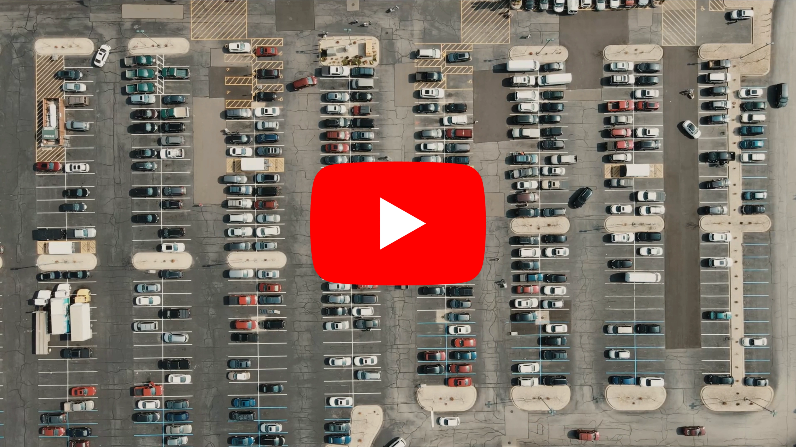
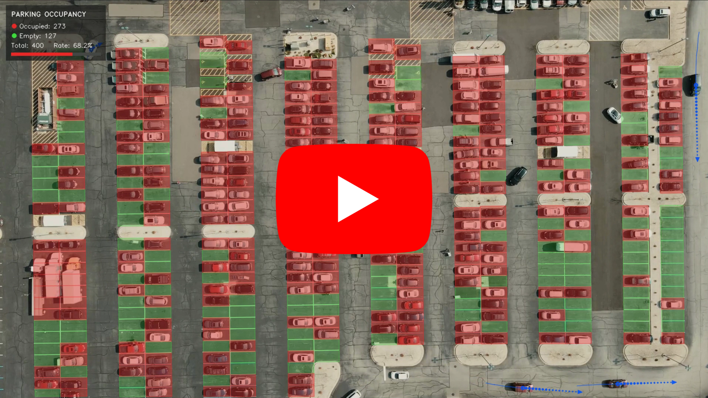
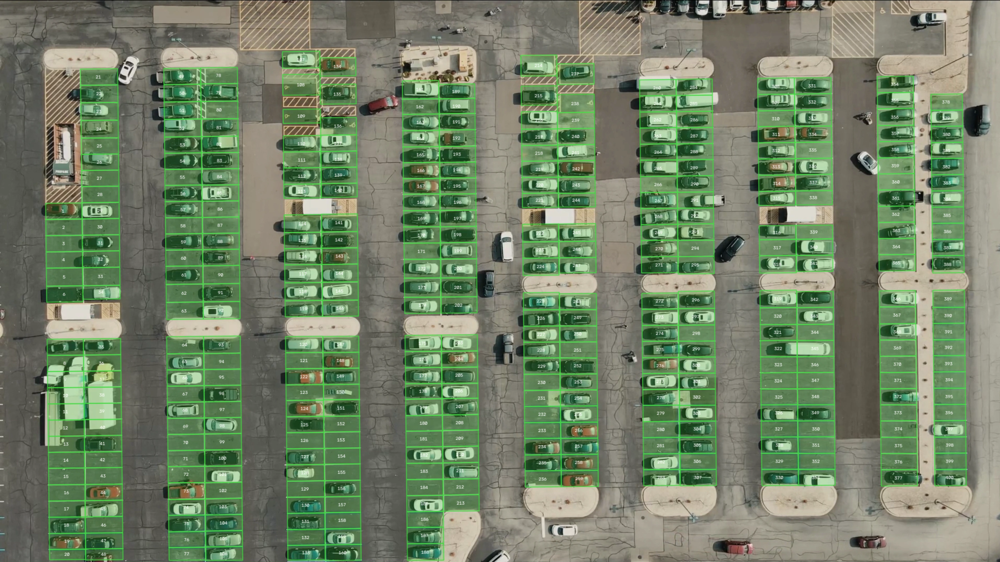

# Parking Lot Occupancy and Vehicle Trajectory Prediction System

## 1. Introduction

This project implements parking lot occupancy analysis and vehicle trajectory prediction for aerial (drone) footage. It finds every parking slot from the painted lines on the ground, detects vehicles with a YOLO detector trained on VisDrone, and labels each slot as occupied or empty in every frame. Occupied slots are filled with transparent red and empty slots with transparent green. Thin slot borders (1 px, anti-aliased, half transparent, drawn at sub-pixel precision) separate them.

The system also tracks the vehicles driving in the aisles and predicts where they are heading. For every moving vehicle outside the parking slots it draws the path it has driven and its predicted path for the next 2 seconds as a blue dotted line with an arrowhead. When the predicted path drives into an empty slot, that slot is outlined as the likely target.

Parking guidance, smart city planning, retail footfall analysis and facility management all need to know how many spaces are free, where they are, and where the cars looking for them are going. Fixed ground sensors add a cost for every slot, while a single drone or rooftop camera can cover the whole lot. The slots are extracted automatically, so no one has to draw the parking spaces by hand.

The test lot has 400 slots across 16 parking lanes. The drone drifts by about 9 px and changes perspective slightly during the 28-second video. The system cancels this motion with homography-based stabilization so the slots stay on the painted lines in every frame. Vehicles are tracked in the same stabilized coordinates, so parked cars stand still and only real movement is followed.

**Core Features:**
- Automatic parking slot extraction from painted lines (no manual annotation)
- Sub-pixel slot borders aligned with the center of the painted divider lines
- Automatic deskew of the lot (-0.73° on the test video)
- Recovery of divider lines hidden under parked vehicles, trucks and trailers with a periodic grid
- Rejection of islands, hatched no-parking zones and painted loading bands
- Accessible slots between hatched access aisles and partly visible slots at the frame border
- Vehicle detection with a VisDrone-trained YOLO model (car, van, truck; trucks and trailers parked across the slots)
- Curb zones (islands, medians, loading bands and hatched blocks inside the parking rows) where no vehicle is ever detected
- Drone motion compensation with Lucas-Kanade optical flow and homography
- Occupancy decision with overlap ratio, temporal smoothing and hysteresis
- Multi-vehicle tracking in stabilized coordinates: OC-SORT style association with ByteTrack two-stage matching and track-aware initialization
- Moving / parked separation with speed and displacement hysteresis
- Heading and turn-rate estimation, with a 2-second predicted path (dotted line and arrowhead) for vehicles moving outside the parking slots
- Likely target slot: the empty slot that a predicted path drives into is outlined
- Live statistics panel (occupied, empty, total, occupancy rate)
- Automatic re-extraction of the slot map when the extraction code or its settings change
- H.264 output video, per-frame occupancy CSV, per-vehicle track CSV and JSON summary report

## 2. Methodology / Approach

The system has two stages. Stage one runs once, on a reference frame: it reads the painted lines and builds a map of parking slot polygons. Stage two runs on every frame: it aligns the frame to the reference, detects vehicles, decides the occupancy of each slot, updates the vehicle tracks and predicts the path of every vehicle moving outside the slots.

### 2.1 System Architecture

The pipeline has eleven steps:

1. **Line Extraction:** A morphological top-hat on $\max(B, G, R)$ isolates thin bright paint; vehicle boxes are masked out so car edges are not read as lines
2. **Deskew:** The lot rotation is found from the sharpest row projection, then refined by fitting lines to divider segments
3. **Lane Detection:** Plateaus of the horizontal line histogram give the parking lanes; double rows are split at the painted center line
4. **Divider Grid:** Divider peaks are found with sub-pixel centroids; hidden dividers are filled in from the slot pitch (up to 6 slots under large vehicles), and row ends are extended next to islands and up to the frame border
5. **Validation:** Slots on islands (bright concrete), hatched zones (yellow diagonal stripes) or painted no-parking bands are rejected; slots between hatched access aisles are placed between the painted blocks
6. **Stabilization:** Reference corner points are tracked into each frame and a homography maps the slot map onto the frame
7. **Vehicle Detection:** The VisDrone YOLO model detects cars, vans and trucks (plus trucks/trailers parked across the slots) at 1280 px input size; detections on curb zones are dropped
8. **Occupancy Decision:** Vehicle/slot overlap, smoothed over time with hysteresis, decides occupied or empty
9. **Vehicle Tracking:** Detections mapped into reference coordinates are matched to tracks with a Kalman filter, box IoU and a direction consistency term
10. **Trajectory Prediction:** For moving vehicles outside the slots, heading and turn rate are estimated and the next 2 seconds are predicted with a constant turn rate and velocity model
11. **Visualization:** Transparent red/green slots, hairline borders, blue trajectories and a statistics panel are drawn on the output video

### 2.2 Implementation Strategy

Parking slots are measured from the image itself instead of being annotated by hand. On the test lot most divider lines are partly hidden by parked cars, so the system does not need a complete line: a divider counts when a small part of it is visible across the lane width. The distance between dividers (the pitch, 31.0 px here) is regular, so gaps of two or three slots are split evenly (up to six when trucks or trailers cover the gap), and empty or vehicle-filled slots at the end of a row are added up to the island or the frame border.

Yellow paint is measured row by row in every lane. Rows covered by paint (hatched access aisles, loading bands) cannot hold a slot. Next to accessible spaces the slots are not on the regular grid: they are placed between the edges of the hatched aisles instead. A van parked across a loading band hides the paint in one row, so the band seen in the other row is carried over to it.

Stabilization tracks points from the reference frame directly into each frame instead of from one frame to the next, so errors do not build up over the video. A forward-backward consistency check and RANSAC remove points on moving vehicles. On the test video a homography lowers the alignment error by 12% to 47% (more in the second half of the video) compared with a similarity transform, because the drone's perspective also changes.

Vehicle boxes are mapped into reference coordinates, where the slot polygons are fixed. A slot is occupied when a vehicle covers at least 30% of its area. Trucks and trailers parked across the slots (box taller than 1.5× its width) cover only part of each slot they block, so 20% is enough for them. An exponential moving average with two thresholds stops a slot from flickering when a single detection is missed.

Islands, medians, loading bands and hatched blocks inside the parking rows are curb zones, and nothing detected there counts as a vehicle. The curb mask is built once from the slot map and the reference frame. Lanes closer than one slot pitch form one parking row, and the gap between them is a median. Everything inside a row that is not a slot is curb. Past both ends of a row, the curb continues as long as the rows of the reference frame are bright concrete, so the islands are covered while the asphalt roads beyond them stay free. Strips narrower than 15 px are removed, so cars turning into a slot are not cut off at the row edge. A detection whose center falls on the curb mask is dropped before both the occupancy decision and the tracker.

The detector runs once per frame. Boxes with a confidence of at least 0.30 drive the occupancy decision. The tracker uses its own thresholds: boxes of at least 0.25 start and update tracks, and boxes between 0.10 and 0.25 only keep existing tracks alive, so a car partly hidden by a tree or a light pole does not lose its track. Tracking also runs in reference coordinates. Seen from above, cars look much alike, so the tracker relies on motion and box overlap rather than appearance features.

A track counts as moving when it is at least 8 frames old, its speed is above 0.5 px/frame (about 4 km/h) and it has moved more than 5 px in the last 15 frames. It drops back to parked below 0.25 px/frame. Per-frame velocity angles are too noisy for a heading (about 1 px of box jitter against about 1 px/frame of motion), so heading and turn rate come from a quadratic fit of the last 30 positions. Only vehicles whose center is outside every slot polygon get a trajectory, so a car that drives into a slot stops being drawn as soon as it enters.

## 3. Mathematical Framework

### 3.1 Painted Line Extraction

Painted lines are thin and brighter than the asphalt around them. The white top-hat transform keeps structures smaller than the structuring element $B$:

$$T(I) = I - (I \circ B)$$

where $I = \max(B, G, R)$ is the brightness channel and $\circ$ is morphological opening. Pixels with $T(I) > 40$ are line candidates. Opening with a $15 \times 1$ kernel keeps horizontal dividers, and a $1 \times 31$ kernel keeps vertical center lines.

### 3.2 Deskew

The rotation angle $\theta$ is chosen to make the row projection of the line mask as sharp as possible:

$$\theta^{\ast} = \arg\max_{\theta} \sum_{y} \Big( \sum_{x} R_{\theta}(M)(x, y) \Big)^{2}$$

where $R_{\theta}$ rotates the line mask $M$. The angle is then refined until the median slope of the divider segments in the rotated image is zero.

### 3.3 Sub-pixel Divider Position

For each lane, the divider profile $p(y)$ is the fraction of the lane width covered by line pixels in row $y$. Each peak is refined with a centroid over a 5-pixel window:

$$\hat{y} = \frac{\sum_{i=-2}^{2} (y_0 + i) p(y_0 + i)}{\sum_{i=-2}^{2} p(y_0 + i)}$$

### 3.4 Hidden Divider Recovery

With lane pitch $s$, the gap $\Delta y$ between two visible dividers holds

$$k = \text{round}\left(\frac{\Delta y}{s}\right), \qquad \left|\Delta y - k s\right| \le 0.22 s, \qquad 1 \le k \le 3$$

slots, and the gap is split into $k$ equal slots. When at least 40% of the gap is covered by vehicles (trucks, trailers), up to $k = 6$ is allowed.

### 3.5 Stabilization Homography

Reference points $\mathbf{p}_i$ are tracked to $\mathbf{q}_i$ in the current frame, and a homography $\mathbf{H}$ is estimated with RANSAC:

$$\lambda (\mathbf{q}_i, 1)^{\top} = \mathbf{H} (\mathbf{p}_i, 1)^{\top}$$

Slot polygons are drawn at $\mathbf{H} \mathbf{P}_{\text{slot}}$, and vehicle boxes are mapped back with $\mathbf{H}^{-1}$.

### 3.6 Occupancy Decision

For slot $S_j$ and vehicles $V_k$ (in reference coordinates):

$$r_j = \max_{k} \frac{\text{area}(S_j \cap V_k)}{\text{area}(S_j)}$$

The per-frame decision $o_j = [r_j \ge 0.30] \lor [r_j^{\text{cross}} \ge 0.20]$, where $r_j^{\text{cross}}$ is the overlap with trucks/trailers parked across the slots, is smoothed with an exponential moving average:

$$e_j^{(t)} = \alpha o_j^{(t)} + (1 - \alpha) e_j^{(t-1)}, \qquad \alpha = 0.35$$

and hysteresis gives the final state: the slot becomes occupied when $e_j \ge 0.60$ and empty when $e_j \le 0.35$.

### 3.7 Vehicle Tracking

Each track has a constant-velocity Kalman filter on its box center $\mathbf{c} = (c_x, c_y)$ and velocity $\mathbf{v} = (v_x, v_y)$ in reference coordinates:

$$\mathbf{x} = (c_x, c_y, v_x, v_y)^{\top}, \qquad \mathbf{c}_{t+1} = \mathbf{c}_t + \mathbf{v}_t, \qquad \mathbf{v}_{t+1} = \mathbf{v}_t$$

High-confidence detections $D_j$ are matched to tracks $T_i$ with the Hungarian algorithm on the cost

$$C_{ij} = 1 - \text{IoU}(T_i, D_j) + \lambda \frac{\Delta\phi_{ij}}{\pi}, \qquad \lambda = 0.2$$

where $\Delta\phi_{ij}$ is the angle between the track's direction (from observations 3 frames apart) and the direction from its last observation to $D_j$. A pair is accepted when $\text{IoU} \ge 0.2$. Unmatched tracks are then matched to low-confidence detections ($\text{IoU} \ge 0.4$), and the rest to the remaining high-confidence detections using their last observed box. A new track starts only from a high-confidence detection whose IoU with every existing track is below 0.5.

When a track is found again after a gap of $g$ frames, the filter is rewound to its last observation $\mathbf{z}_{t_0}$ and re-run over virtual observations

$$\tilde{\mathbf{z}}_{t_0 + i} = \mathbf{z}_{t_0} + \frac{i}{g}\left(\mathbf{z}_{t_0 + g} - \mathbf{z}_{t_0}\right), \qquad i = 1, \dots, g - 1$$

so the velocity is not corrupted by blind prediction during the gap.

### 3.8 Heading and Turn Rate

The last $W = 30$ positions are fitted with a quadratic in time ($\tau \le 0$, $\tau = 0$ is the current frame):

$$x(\tau) = a_x \tau^2 + b_x \tau + c_x, \qquad y(\tau) = a_y \tau^2 + b_y \tau + c_y$$

The velocity is $\mathbf{v} = (b_x, b_y)$ and the acceleration is $\mathbf{a} = (2a_x, 2a_y)$. Heading and turn rate are

$$\theta = \text{atan2}(v_y, v_x), \qquad \omega = \frac{v_x a_y - v_y a_x}{\lVert \mathbf{v} \rVert^2}$$

Turn rates below 10°/s are set to zero (straight driving), larger ones are clipped at 90°/s and smoothed with an exponential moving average ($\alpha = 0.3$).

### 3.9 Path Prediction

The predicted path uses a constant turn rate and velocity (CTRV) model. The turn rate decays along the path so the prediction does not curl into a circle:

$$\theta_{k+1} = \theta_k + \omega_k, \qquad \omega_{k+1} = 0.97 \omega_k, \qquad \mathbf{p}_{k+1} = \mathbf{p}_k + \lVert \mathbf{v} \rVert (\cos\theta_{k+1}, \sin\theta_{k+1})^{\top}$$

for $k = 0, \dots, 59$ (2 seconds at 30 FPS). The likely target slot is the first empty slot whose center lies within $0.6 s$ of the predicted path, where $s$ is the slot pitch.

## 4. Requirements

`requirements.txt`

```txt
opencv-python>=4.8.0
numpy>=1.24.0
scipy>=1.10.0
ultralytics>=8.3.0
```

FFmpeg is optional. When it is installed, the output video is encoded as H.264; otherwise OpenCV writes MPEG-4 (`mp4v`).

## 5. Installation & Configuration

### 5.1 Environment Setup

```bash
# Clone the repository
git clone https://github.com/kemalkilicaslan/Parking-Lot-Occupancy-and-Vehicle-Trajectory-Prediction-System.git
cd Parking-Lot-Occupancy-and-Vehicle-Trajectory-Prediction-System

# Install required packages
pip install -r requirements.txt
```

### 5.2 Project Structure

```
Parking-Lot-Occupancy-and-Vehicle-Trajectory-Prediction-System
├── Parking-Lot-Occupancy-and-Vehicle-Trajectory-Prediction-System.py
├── config.py
├── Dockerfile
├── .dockerignore
├── docker-compose.yml
├── .gitignore
├── README.md
├── requirements.txt
└── LICENSE
```

### 5.3 Configuration Parameters

All adjustable parameters are in `config.py`, so you can change them without editing the main script.

**Model and Detection:**

```python
MODEL_PATH = "visdrone.pt"
VEHICLE_CLASSES = ("car", "van", "truck")   # VisDrone classes counted as vehicles

IMG_SIZE = 1280              # inference size (aerial cars are ~58x26 px at 1080p)
CONF_THRESH = 0.30           # detection confidence threshold (occupancy)
MAX_DET = 2000               # a crowded lot exceeds the default limit of 300
```

**Parking Slot Extraction:**

```python
REF_FRAME = 0                # frame used for slot extraction and as stabilization reference
REBUILD_SLOTS = False        # True = always extract the slots again
LINE_THRESH = 40             # top-hat threshold for painted line pixels
MAX_MISSING = 3              # max. consecutive dividers hidden by vehicles
MAX_MISSING_COVERED = 6      # max. hidden dividers under large vehicles (trucks, trailers)
EXTRAPOLATE = 2              # max. slots added at each row end (next to islands)
PAINT_ROW_FRAC = 0.20        # yellow paint ratio that marks a lane row as no-parking
PAINT_SLOT_FRAC = 0.4        # painted row ratio that rejects a slot
EDGE_MIN_VISIBLE = 0.6       # min. visible part of a slot cut by the frame border
```

**Occupancy Decision:**

```python
OVERLAP_THRESH = 0.30        # vehicle area / slot area needed to call a slot occupied
EMA_ALPHA = 0.35             # temporal smoothing factor of the occupancy score
ON_THRESH = 0.60             # smoothed score above which a slot becomes occupied
OFF_THRESH = 0.35            # smoothed score below which a slot becomes empty
CROSSWISE_CLASSES = ("truck", "bus")   # large vehicles parked across the slots (trailers = "bus")
CROSSWISE_ASPECT = 1.5       # box height / width above which a vehicle lies across the slots
CROSSWISE_OVERLAP = 0.20     # overlap with a crosswise vehicle that marks a slot occupied
```

**Curb Zones:**

```python
CURB_EXCLUDE = True          # drop every detection whose centre lies on a curb zone
CURB_LANE_GAP = 1.0          # lanes closer than this (x pitch) form one row, the gap is a median
CURB_ISLAND_FRAC = 0.3       # bright concrete ratio of a row that extends an island past the row end
CURB_ISLAND_GAP = 6          # weaker rows allowed inside an island (lamp posts, cracks)
CURB_ISLAND_START = 1.0      # weaker rows allowed before an island starts (x pitch, planters)
CURB_MAX_EXTENT = 5.0        # max. island length past the row end (x pitch)
CURB_MIN_WIDTH = 15          # thinner strips are not curbs (px), keeps row edges free

```

**Vehicle Tracking and Trajectory Prediction:**

```python
TRACK_HIGH_THRESH = 0.25     # min. confidence to start or first-stage match a track
TRACK_LOW_THRESH = 0.10      # min. confidence for the second matching stage
MATCH_IOU_HIGH = 0.20        # min. IoU for high-confidence matches and recovery
MATCH_IOU_LOW = 0.40         # min. IoU for low-confidence matches
OCM_WEIGHT = 0.20            # weight of the direction consistency cost
NEW_TRACK_IOU = 0.50         # no new track from a box overlapping an existing track this much
MAX_MISSED = 12              # frames a track survives without a detection

MOVE_ON_SPEED = 0.50         # px / frame above which a track becomes moving (~4 km/h)
MOVE_OFF_SPEED = 0.25        # px / frame below which a moving track becomes parked
MOVE_MIN_DISPLACEMENT = 5.0  # px a car must travel within MOVE_WINDOW to count as moving

PREDICT_SECONDS = 2.0        # how far ahead the dotted path is predicted
HEADING_WINDOW = 30          # past positions fitted for heading and turn rate
YAW_DEADBAND_DEG = 10.0      # turn rates below this count as straight driving (deg / s)
PREDICT_TARGET_SLOT = True   # outline the empty slot a predicted path drives into
SLOT_WIDTH_M = 2.5           # real width of one parking slot (m), used for km/h
```

**Visualization:**

```python
COLOR_OCCUPIED = (40, 40, 235)   # BGR red
COLOR_EMPTY = (60, 220, 60)      # BGR green
ALPHA_OCCUPIED = 0.40            # transparency of the red fill
ALPHA_EMPTY = 0.22               # transparency of the green fill
SHOW_SLOT_BORDERS = True         # draw thin slot border lines
BORDER_ALPHA = 0.5               # opacity of the 1 px border lines
SHOW_SLOT_IDS = False            # draw slot numbers
SHOW_BOXES = False               # draw vehicle detection boxes
TRACK_COLOR = (255, 80, 0)       # BGR blue (trajectories)
TRAIL_LENGTH = 45                # past positions drawn as a solid trail (frames)
```

## 6. Usage / How to Run

### 6.1 Basic Execution

```bash
python Parking-Lot-Occupancy-and-Vehicle-Trajectory-Prediction-System.py
```

**Requirements:**
- Input video: `Aerial-Parking-Lot.mp4` (place in project directory)
- VisDrone YOLO model: `visdrone.pt` (place in project directory)

**Controls:**
- Press `q` to quit during playback

**Outputs:**
- `Parking-Lot-Occupancy-and-Vehicle-Trajectory-Prediction.mp4`: annotated output video
- `Parking-Lot-Slots.json`: slot polygons in reference frame coordinates
- `Parking-Lot-Slots.png`: numbered slot map
- `Parking-Lot-Occupancy-timeseries.csv`: per-frame occupancy, camera motion and number of moving vehicles
- `Parking-Lot-Vehicle-Tracks.csv`: per-frame position, speed, heading, turn rate, predicted position and target slot of every vehicle with a trajectory
- `Parking-Lot-Occupancy-summary.json`: overall statistics, per-slot occupancy ratio and per-vehicle trajectory summary

### 6.2 Using a Different Parking Lot Video

1. Set `INPUT_VIDEO` in `config.py`
2. Run the script: the slots are extracted again automatically because the video setting changed (`REBUILD_SLOTS = True` forces it)
3. Check `Parking-Lot-Slots.png`; if lines are missed, lower `LINE_THRESH`, or raise it if asphalt cracks are picked up
4. Set `REF_FRAME` to a frame where the camera is steady and the lot is clearly visible
5. Set `SLOT_WIDTH_M` to the real slot width of the new lot, so the speeds in the outputs stay correct

### 6.3 Tuning the Occupancy Decision

```python
# A vehicle must cover more of the slot (fewer false "occupied")
OVERLAP_THRESH = 0.45

# Faster reaction to vehicles arriving and leaving (more flicker)
EMA_ALPHA = 0.6

# Show slot numbers and detections for debugging
SHOW_SLOT_IDS = True
SHOW_BOXES = True
```

### 6.4 Tuning the Trajectories

```python
# Slow vehicles are missed: count lower speeds as moving
MOVE_ON_SPEED = 0.35

# Parked cars get a trajectory: require more travel before a vehicle counts as moving
MOVE_MIN_DISPLACEMENT = 8.0

# New vehicles are picked up late: start tracks from less confident detections
TRACK_HIGH_THRESH = 0.60

# Shorter or longer predicted path
PREDICT_SECONDS = 1.5
```

## 7. Docker Deployment

Running the system in a container keeps the code, its dependencies and the runtime
environment the same on every machine.

### Files

- `Dockerfile`: builds the image (Python 3.11 + OpenCV/ffmpeg system libraries + Python dependencies).
- `.dockerignore`: keeps large media, model files and generated reports out of the build context.
- `docker-compose.yml`: runs the container and mounts the project folder for input/output.

### Build and run

```bash
# Build the image and run the container
docker compose up --build

# Or use the Docker CLI directly
docker build -t parking-lot-occupancy-and-vehicle-trajectory-prediction:latest .
docker run --rm -v "$(pwd)":/app parking-lot-occupancy-and-vehicle-trajectory-prediction:latest
```

### Notes

- The model weight (`visdrone.pt`) and the input video are read from the mounted
  project folder; they are not copied into the image.
- The container runs headless: `SHOW_WINDOW=0` is set in the `Dockerfile`, so the
  `cv2.imshow` preview is disabled and the outputs are written to the project folder.
- Inside Docker the model runs on the CPU. GPU acceleration (CUDA, or MPS on Apple
  Silicon) is available when the script is run directly on the host.

## 8. Application / Results

### 8.1 Input Video

**Aerial Parking Lot:**

[](https://www.youtube.com/watch?v=1gq8OuhcC00)

*1920×1080, 30 FPS, 28.3 s, 849 frames, H.264 drone footage of the parking lot.*

### 8.2 Output Video

**Parking Lot Occupancy and Vehicle Trajectory Prediction:**

[](https://www.youtube.com/watch?v=FT8M5UBCCr4)

*Reference frame: 275 occupied (transparent red) and 125 empty (green) slots, 68.8% occupancy. Over the video the occupied count stays between 271 and 275 (mean 272.4, 68.1%). Vehicles moving outside the slots get a blue trail and a dotted 2-second predicted path. The thumbnail shows the frame at 11 s (273 occupied, 68.2%).*

### 8.3 Parking Slot Map

**Parking Lot Slots:**



*400 slots extracted automatically from the painted lines, numbered lane by lane and shown on the frame at 11 s. Islands, hatched zones and loading bands are left out.*

### 8.4 Slot Extraction Results

| Metric | Value | Notes |
|--------|-------|-------|
| Parking Lanes | 16 | 7 double rows + 2 single rows |
| Parking Slots | 400 | Extracted from the reference frame |
| Lot Rotation (Deskew) | -0.729° | Refined until residual slope < 0.01° |
| Slot Pitch | 31.0 px | Distance between divider lines |
| Detected Vehicles (Reference Frame) | 317 | `MAX_DET` raised above the default 300 |

### 8.5 Stabilization Results

| Metric | Value | Notes |
|--------|-------|-------|
| Max. Camera Drift | ~9 px | Measured at the image center across the video |
| Tracking Inliers | ~1,740 to 2,000 | Points per frame after RANSAC (homography) |
| Alignment Error Reduction | 12% to 47% | Homography vs. similarity transform |
| Stabilization Time | ~33 ms/frame | Lucas-Kanade at 0.5 scale |

### 8.6 Trajectory Results

| Metric | Value | Notes |
|--------|-------|-------|
| Vehicles with Trajectory | 21 | Moving outside the parking slots at some point of the video |
| Moving Vehicles per Frame | 0 to 10 | Mean 5.6 |
| Speed (Median / Max.) | 11.9 / 30.8 km/h | Assumes a slot width of 2.5 m |
| Longest Moving Distance | 112.4 m | One car, moving for 19.4 s |
| Target Slot Predictions | 1 | One car turning into slot 118 |
| Processing Time | ~0.44 s/frame | 849 frames in 370 s on the test machine |

### 8.7 System Parameters

| Parameter | Value | Unit | Description |
|-----------|-------|------|-------------|
| Inference Size | 1280 | pixels | YOLO input size |
| Detection Confidence | 0.30 | - | Vehicle detection threshold (occupancy) |
| Overlap Threshold | 0.30 | - | Vehicle area / slot area |
| EMA Alpha | 0.35 | - | Temporal smoothing factor |
| Hysteresis | 0.60 / 0.35 | - | Occupied / empty switch levels |
| Top-hat Kernel | 9 | pixels | Painted line isolation |
| Line Threshold | 40 | - | Top-hat intensity threshold |
| Track Confidence | 0.25 / 0.10 | - | High / low threshold of the two matching stages |
| Moving Speed | 0.50 / 0.25 | px/frame | Moving / parked switch levels |
| Heading Window | 30 | frames | Quadratic fit for heading and turn rate |
| Prediction Horizon | 2.0 | seconds | Length of the dotted predicted path |
| Slot Border Thickness | 1 | pixel | Anti-aliased, 4-bit sub-pixel, 50% opacity |
| Occupied Color | RED | (40, 40, 235) | BGR, 40% fill |
| Empty Color | GREEN | (60, 220, 60) | BGR, 22% fill |
| Trajectory Color | BLUE | (255, 80, 0) | BGR, trail, predicted path and target slot |

## 9. Tech Stack

### 9.1 Core Technologies

- **Programming Language:** Python 3.8+
- **Computer Vision:** OpenCV 4.8+
- **Object Detection:** YOLO trained on VisDrone (Ultralytics)
- **Multi-Object Tracking:** OC-SORT style tracker with ByteTrack two-stage matching (own implementation)
- **Signal Processing and Matching:** SciPy (divider peak detection, Hungarian assignment)
- **Video Processing:** OpenCV VideoCapture + FFmpeg (H.264 encoding)

### 9.2 Libraries & Dependencies

| Library | Version | Purpose |
|---------|---------|---------|
| opencv-python | 4.8+ | Morphology, optical flow, homography, rendering, video I/O |
| numpy | 1.24+ | Array operations, geometry, Kalman filter, trajectory fitting |
| scipy | 1.10+ | Peak detection on divider profiles, track/detection assignment |
| ultralytics | 8.3+ | YOLO model inference |

### 9.3 Model Architecture

**VisDrone YOLO Detector:**
- **Model File:** visdrone.pt (~118 MB)
- **Input Resolution:** 1280×1280 pixels
- **Training Data:** VisDrone (drone-view images and videos)
- **Detection Classes:** 10 classes (pedestrian, people, bicycle, car, van, truck, tricycle, awning-tricycle, bus, motor); filtered to car, van and truck
- **Note:** `bus` is not a parked-vehicle class because the model labels the concrete islands as buses on this lot. It is used only for trailers parked across the slots: those boxes are tall, while the island boxes are wide

### 9.4 Computer Vision Components

| Component | OpenCV Function | Purpose |
|-----------|-----------------|---------|
| Top-hat Transform | `cv2.morphologyEx(MORPH_TOPHAT)` | Painted line isolation |
| Directional Opening | `cv2.morphologyEx(MORPH_OPEN)` | Horizontal dividers / vertical center lines |
| Corner Detection | `cv2.goodFeaturesToTrack()` | Stabilization reference points |
| Optical Flow | `cv2.calcOpticalFlowPyrLK()` | Reference-to-frame point tracking |
| Homography | `cv2.findHomography(RANSAC)` | Drone motion compensation |
| ORB Matching | `cv2.ORB_create()` | Stabilization fallback |
| Convex Intersection | `cv2.intersectConvexConvex()` | Vehicle/slot overlap area |
| Point in Polygon | `cv2.pointPolygonTest()` | Parking area test for trajectories |

## 10. License

This project is licensed under the [Creative Commons Attribution-NonCommercial-NoDerivatives 4.0 International (CC BY-NC-ND 4.0)](https://github.com/kemalkilicaslan/Parking-Lot-Occupancy-and-Vehicle-Trajectory-Prediction-System/blob/main/LICENSE).

## 11. References

1. Ultralytics [YOLO](https://docs.ultralytics.com/) Documentation.
2. VisDrone [Dataset](https://github.com/VisDrone/VisDrone-Dataset) Repository.
3. OpenCV [Morphological Transformations](https://docs.opencv.org/4.x/d9/d61/tutorial_py_morphological_ops.html) Documentation.
4. OpenCV [Optical Flow](https://docs.opencv.org/4.x/d4/dee/tutorial_optical_flow.html) Documentation.
5. OpenCV [Feature Matching + Homography](https://docs.opencv.org/4.x/d1/de0/tutorial_py_feature_homography.html) Documentation.
6. Zhang, Y., et al. (2022). [ByteTrack: Multi-Object Tracking by Associating Every Detection Box](https://arxiv.org/abs/2110.06864). *ECCV 2022*.
7. Cao, J., et al. (2023). [Observation-Centric SORT: Rethinking SORT for Robust Multi-Object Tracking](https://arxiv.org/abs/2203.14360). *CVPR 2023*.
8. Shim, K., et al. (2025). [Focusing on Tracks for Online Multi-Object Tracking](https://github.com/kamkyu94/TrackTrack). *CVPR 2025*.

---

### Acknowledgments

Vehicle detection uses Ultralytics YOLO with a VisDrone-trained model. Line analysis, stabilization and rendering use OpenCV. The tracker follows ideas from ByteTrack, OC-SORT and TrackTrack. Thanks to the VisDrone team and the computer vision community for their open datasets and tools.

---

**Note:** This system is intended for research, education, and parking analysis purposes. Slot extraction assumes a top-down view with painted divider lines and yellow no-parking markings; rows where more than six dividers in a row are hidden by vehicles in the reference frame may be missed. Check the generated slot map before using the results. Speeds in the outputs assume a slot width of 2.5 m, and the predicted path assumes the vehicle keeps its current speed and turn rate for the next 2 seconds.
